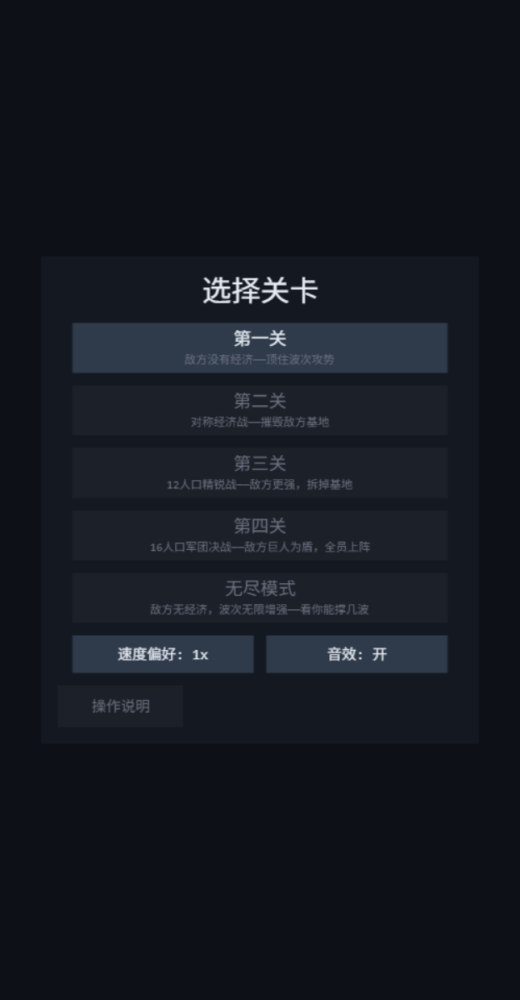
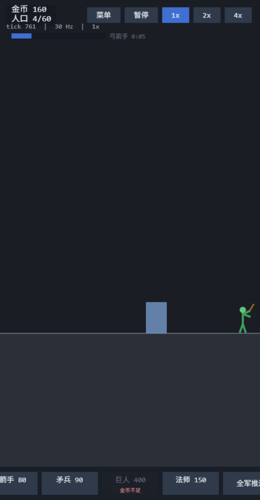

# 火柴人战争（stick-war-web）

浏览器端的单机 2D 即时战略游戏，玩法致敬《火柴人战争：遗产》。纯静态站点，无后端。

**在线试玩：https://turnaround02.github.io/stick-war-web/**

| 菜单 | 战斗 |
|---|---|
|  |  |

## 玩法

经营金矿 → 征募火柴人 → 在一条横向战线上与 AI 交战 → 摧毁敌方基地。

- **单轴战场**：所有单位只在一条水平线上移动，战线一目了然；滚轮/双指缩放（0.6x~1.2x）观察全局或微操。
- **姿态制指挥**：不做框选、不做点地移动——全军只有「推进 / 驻守 / 撤退」三种姿态，快捷键 Q/W/E。
- **六种兵种**：矿工（经济）、剑士（反轻甲）、弓箭手（远程，需前排掩护）、矛兵（反重甲/长柄）、巨人（重甲坦克）、法师（远程眩晕）。
- **四个战役关卡 + 无尽模式**：
  1. 第一关——敌方没有经济，顶住波次攻势
  2. 第二关——对称经济战，摧毁敌方基地
  3. 第三关——12 人口精锐战，敌方更强
  4. 第四关——16 人口军团决战，敌方巨人为盾、全员上阵
  5. 无尽模式——敌方无经济，波次无限增强，看你能撑几波
- **操作**：A/D 或 ←/→ 滚动（触屏拖动）· 空格暂停 · R 重玩 · 速度 1x/2x/4x。

进度保存在浏览器 localStorage（最远解锁关卡、无尽最高波次、速度与音效偏好）。

## 技术栈

- **Phaser 4**（渲染与输入）
- **TypeScript** + **Vite**（构建）
- **Vitest**（逻辑核心单测，**905 条**）
- 零美术资源——所有火柴人都是程序化绘制的骨骼动画（Phaser Container + Shape，按关键帧插值肢体旋转）。

## 架构

```
src/
├── data/     纯数据：兵种表、关卡表、常量（秒 → tick 只在此换算一次）
├── sim/      纯逻辑核心：六步 tick 编排器（经济→指令→AI→运动→战斗→清理）
│             禁止 import phaser（ESLint 强制）；确定性：种子 PRNG、整数 tick、
│             世界状态哈希回归测试
├── input/    键鼠/触屏 → Command 适配器（纯模块，可单测）
├── render/   Phaser 场景、火柴人骨骼、HUD、相机、音效
│             只读 sim 状态，从不写回；可判定的几何/状态抽成 Phaser-free 纯模块并配测试
├── i18n/     中文文案表（代码英文，UI 中文）
└── save/     localStorage 存档（容错读写）
```

两条核心铁律：

1. **`sim/` 不依赖 Phaser、不含任何非确定性来源**（禁 `Math.random`/`Date.now`）——同一份种子在任何速度下产出完全相同的对局，由世界状态哈希回归测试钉死。
2. **渲染层可判定的逻辑必须抽成 Phaser-free 模块并配测试**——布局矩形、按钮状态、点击守卫、手势状态机全部是纯函数，窄视口行为有专项断言。

## 本地开发

```bash
npm install
npm run dev      # 开发服务器（http://localhost:8080/stick-war-web/）
npm test         # Vitest 全量单测
npm run lint     # ESLint（含 sim 边界检查）
npm run build    # 生产构建（dist/）
```

## 部署

推送到 `master` 即自动构建并发布到 GitHub Pages（`.github/workflows/deploy.yml`：npm ci → tsc → eslint → vite build → Pages 工件流）。

## 设计文档

完整设计规格（含全部决策记录）与实施史见 [`docs/superpowers/`](docs/superpowers/)；各里程碑的交付记录与「容易忘的设计」见 [`AGENTS.md`](AGENTS.md)。
